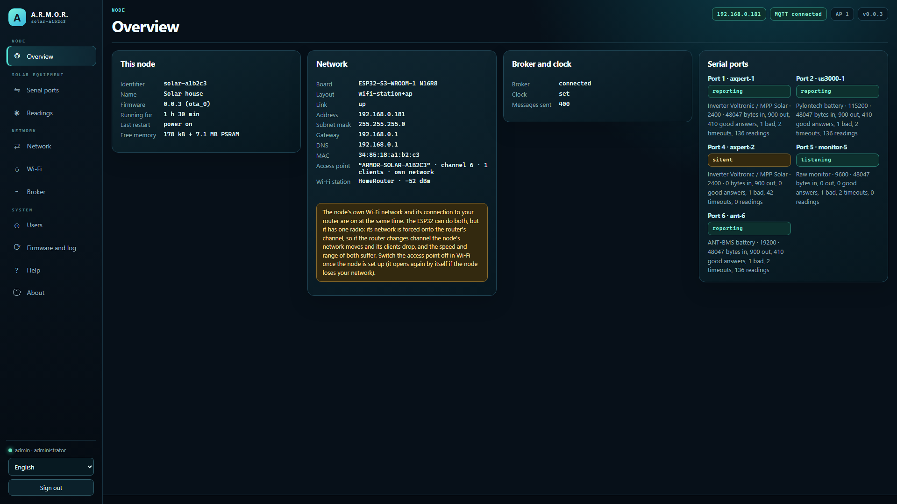
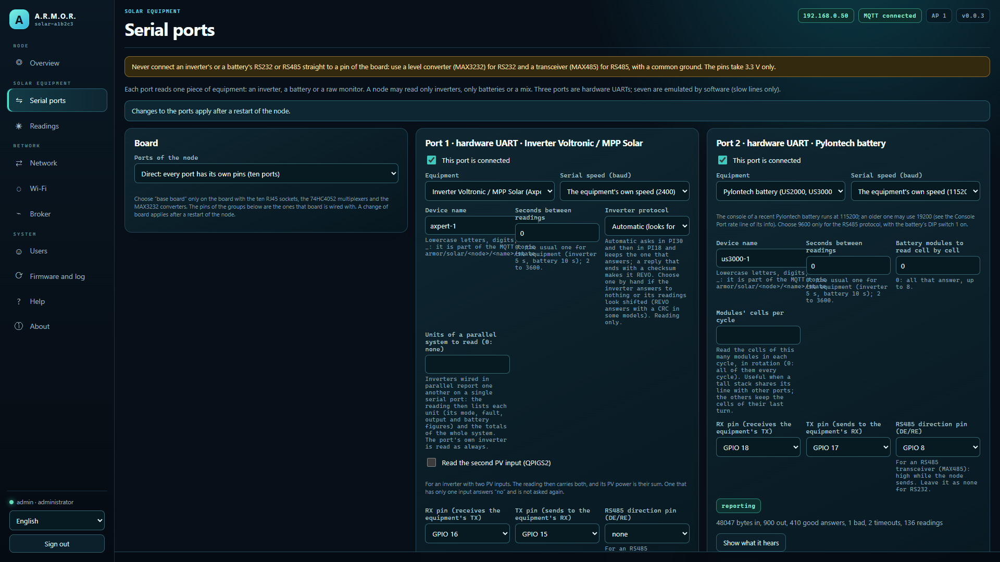
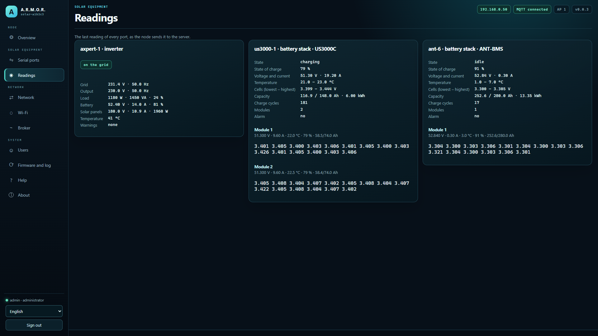
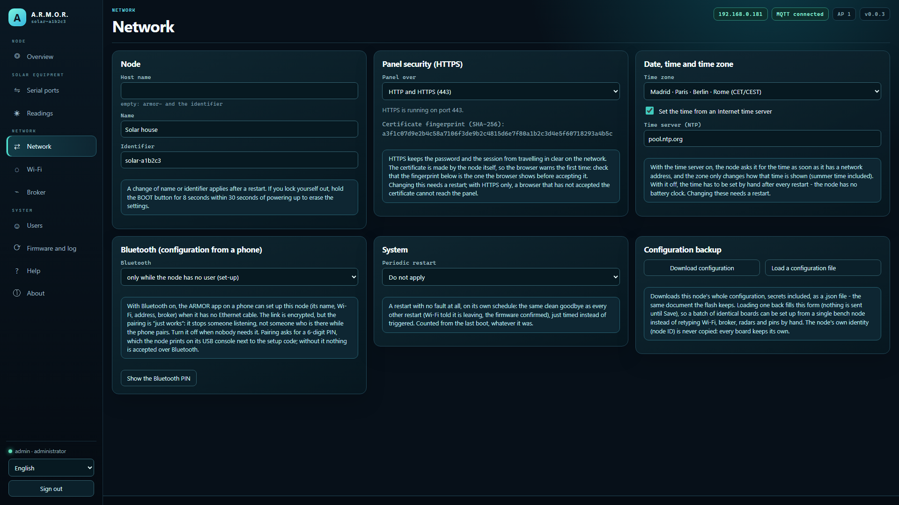

<p align="center">
  
</p>

# ☀️ ARMOR-SOLAR

<p align="center">
  <a href="README.md">🇺🇸 English</a> |
  <a href="README_spa.md">🇪🇸 Español</a> |
  🇫🇷 <b>Français</b> |
  <a href="README_ita.md">🇮🇹 Italiano</a> |
  <a href="README_deu.md">🇩🇪 Deutsch</a> |
  <a href="README_zho.md">🇨🇳 简体中文</a> |
  <a href="README_jpn.md">🇯🇵 日本語</a> |
  <a href="README_por.md">🇵🇹 Português</a>
</p>

### Nœud passerelle solaire : lit onduleurs et batteries par jusqu'à dix ports série (firmware ESP32-S3, son panneau web et la bibliothèque de protocoles)

<p align="center">
  
  
  
  
  
</p>

---

**Vérification d'honnêteté - ce qui fonctionne aujourd'hui:** Le firmware se compile dans le conteneur ESP-IDF 5.5.5, son cœur (les réglages, l'échange avec chaque type d'équipement, l'arithmétique de l'UART émulée, le canal Bluetooth, les contrôles de version et de signature : 3 013 vérifications dans 10 programmes de test) est testé sur un ordinateur avec des équipements factices, les messages qu'il produit sont acceptés par ARMOR-COMMON et le panneau a été exercé dans un navigateur contre un nœud factice. **Il n'a jamais tourné sur une carte et aucun onduleur ni batterie n'a été connecté** : le Wi-Fi, le panneau sur TLS, la mise à jour, les UART matérielles et émulées et les formats des protocoles (écrits d'après des documents publics et de mémoire) ne sont pas essayés. Les trames ANT-BMS de ses tests ont été capturées par d'autres personnes sur leurs propres unités : ce projet n'en a lu aucune lui-même.

---

## 📋 En un coup d'œil

| | |
|---|---|
| Version | `0.5.5` |
| Maturité | Fonctionnel |
| Tests | 10 527 vérifications dans 14 programmes (`ctest`) |
| Technologie | C++17 (host-tested core); ESP-IDF 5.5.5 firmware for the ESP32-S3-WROOM-1 N16R8 (Wi-Fi) and the Waveshare ESP32-S3-ETH (Ethernet); JavaScript web panel |
| Sur matériel réel | Aucun pour l'instant : aucune carte montée ni onduleur ou batterie connecté (seulement des tests sur ordinateur, la compilation et le panneau dans un navigateur) |

## 🎯 Présentation

* **Deux cartes, un firmware :** une ESP32-S3-WROOM-1 N16R8 en Wi-Fi (par défaut) et la Waveshare ESP32-S3-ETH sur son câble Ethernet (DHCP ou adresse fixe ; son propre réseau Wi-Fi est conservé pour la joindre depuis un téléphone). L'image se choisit à la compilation (`tools/build_node.sh generic s3-wifi` ou `generic s3-eth`) ; la table des broches, les broches par défaut des ports et l'accès suivent la carte, et une image ne vaut que pour sa carte. Les deux compilent et sont testées sur ordinateur ; aucune n'a tourné sur une carte.
* **Le firmware du nœud** (ESP32-S3-WROOM-1 N16R8 en Wi-Fi, ou Waveshare ESP32-S3-ETH sur câble) : dix ports série, trois UART matériels et sept émulés (jusqu'à 19200 bauds), chacun indépendant et lisant un onduleur, une batterie ou un moniteur brut, si bien qu'un nœud peut lire seulement des onduleurs, seulement des batteries ou un mélange.
* **Le panneau web du nœud,** celui des nœuds radar aussi : configuration avec un code affiché sur la console USB, connexion et utilisateurs, Wi-Fi (station et point d'accès), broker, mise à jour par radio avec retour arrière, journal, HTTPS, et les pages des ports (avec ce que chacun entend, pour les protocoles pas encore décodés) et des relevés, en huit langues.
* **Onduleurs Voltronic / MPP Solar** (Axpert, PIP, InfiniSolar et clones), RS232 à 2400 bauds : les trames et leur CRC, et les relevés `QPIGS` (réseau, sortie, batterie, PV, bits d'état), `QMOD` (mode), `QPIWS` (avertissements et pannes par nom) et `QPIRI` (valeurs nominales). Seules les commandes de lecture peuvent être construites : un réglage change la façon dont la maison est alimentée. Trois dialectes, choisis sur le port ou trouvés par lui (*auto*) : PI30, REVO (un autre `QPIGS`, réponses avec somme de contrôle) et PI18 (`^P005GS` : InfiniSolar V, LV5048, SunGoldPower), en lecture seule.
* **Batteries Pylontech** (US2000, US3000, US5000) : le tableau `pwr` de la console (tension, courant, températures et état de charge de chaque module), `bat <n>` (tension et température de chaque cellule) et `info <n>` (modèle, capacité restante et totale, cycles), résumés en une pile avec sa capacité et son énergie totales, et la trame RS485 avec ses deux contrôles. Les formats sont écrits de mémoire de la console publique et peuvent varier selon les firmwares. Les colonnes sont trouvées par les noms de l'en-tête (y compris le format de l'US5000 V2.3 avec ses colonnes Id, MosTempr et SysAlarm.St), la charge restante et l'équilibrage viennent de `bat`, et le modèle, la capacité nominale et les cycles de `info` et `stat`, demandés une fois et gardés une demi-heure.
* **Ce qu'un module Pylontech dit de lui-même :** son modèle et les versions de sa carte et de son logiciel, ses cellules et le courant qu'il admet, les compteurs de sa vie (`stat`), la santé de chaque cellule (`soh`, l'anormale marquée) et l'entrée la plus récente de son journal d'événements, avec les noms des protections tels que la console les imprime. La console ne fait que lire, et un administrateur peut télécharger sous forme de fichier texte ce qu'un port a entendu.
* **Les messages du nœud** (`armor/solar/<nœud>/<appareil>/state`, un par onduleur ou pile de batteries), définis dans ARMOR-COMMON avec schémas et vecteurs de conformité ; ce que produisent les ports est vérifié contre eux.
* **Batteries ANT-BMS** (les cartes noires des packs faits maison, 7S à 32S), UART 3,3 V à 19200 bauds : les deux protocoles de son firmware (le nœud demande dans l'un puis dans l'autre et garde celui qui répond), avec les cellules, les températures, l'état de charge, le courant, les capacités et les états des MOSFET et de l'équilibreur, vérifiés sur des trames capturées sur quatre modèles réels. Lecture seule : ses commandes d'écriture peuvent déconnecter une batterie en charge. Un bouton de la page des ports lit aussi le modèle, la version et les 56 réglages de protection et d'équilibrage du BMS (protocole récent), en lecture seule.
* **Configuration depuis le téléphone en Bluetooth,** le même canal que celui du nœud radar : l'app ARMOR trouve le nœud sous le nom `ARMOR-XXXXXX` et règle son nom, son Wi-Fi, son adresse, son broker et son mode Bluetooth avec les utilisateurs et le code de mise en service du panneau ([le protocole](docs/BLE_PROVISIONING.md)). Il n'écoute que tant que le nœud n'a pas d'utilisateur, sauf réglage contraire. La partie radio n'a jamais tourné sur une carte.
* **La carte de base avec multiplexeurs (le profil *mux*) :** trois UART matériels, chacun derrière un 74HC4052, desservent jusqu'à huit ports en groupes de 4, 2 et 2 qui se relaient sur leur ligne, chaque port avec sa propre vitesse et sa propre polarité, et une LED par port via un 74HC595 ; les cellules d'une grande pile Pylontech peuvent être lues à tour de rôle. Pour un onduleur en dialecte standard, la **seconde entrée photovoltaïque** (`QPIGS2`) et les **unités d'un système en parallèle** (`QPGS`) sont des lectures facultatives. Rien de tout cela n'a tourné sur une carte.
* **Mises à jour par radio signées :** le nœud n'installe depuis GitHub qu'une image dont le SHA-256 correspond et qui porte une signature Ed25519 valide du responsable (la clé publique est dans le firmware, la privée ne quitte jamais le responsable) ; un fichier envoyé à la main par un administrateur dans le panneau reste accepté. Les pages et messages du panneau sont en huit langues.
* **Appairage Bluetooth avec un PIN :** le PIN à six chiffres est dérivé du code de configuration, imprimé sur la console USB et montré à un administrateur dans le panneau ; le téléphone doit le saisir avant de pouvoir écrire les réglages du nœud.
* **Pas encore :** la liaison Bluetooth de l'ANT-BMS (le nœud utilise le câble, le plus stable des deux) et un essai sur une vraie carte avec de vrais équipements.
* **Seule la maison peut utiliser le panneau :** le panneau répond par défaut au réseau privé (ou aux réseaux que son propriétaire indique, comme un VPN), refuse une liste qui exclurait celui qui l'enregistre, compte les mauvais mots de passe par personne et par adresse, et fonctionne derrière le proxy du serveur pour être atteint depuis l'extérieur sans publier le nœud.**Inconnu ne veut pas dire aucun :** un onduleur REVO n'a pas de requête d'avertissements, son message porte donc `warnings_known: false` et Studio affiche les avertissements comme inconnus et non comme "aucun".
* **Liaison chiffrée facultative avec le broker (TLS) :** désactivée par défaut, le nœud parle donc MQTT non chiffré comme avant. Un interrupteur et une zone pour le certificat de l'autorité propre à l'installation (PEM, 2 Ko au plus) dans la page Broker lui font se connecter en `mqtts://`, ne faire confiance qu'à cette autorité et vérifier que le certificat du broker a été établi pour l'adresse atteinte ; ce qui n'est pas un seul certificat PEM est refusé. Couvert par des tests sur ordinateur ; la poignée de main n'a pas encore été exécutée sur une carte.
* **Rapport de santé :** environ une fois par minute le nœud publie depuis combien de temps il tourne et pourquoi il a redémarré la dernière fois, sa mémoire libre, sa liaison et son signal Wi-Fi, combien de fois il s'est connecté au broker et la dernière erreur notée (`armor/health/<nœud>`, le contrat `node_health` d'ARMOR-COMMON). Le code qui le construit est partagé par tous les nœuds et testé sur un ordinateur ; il n'a pas tourné sur une carte.
* **Écriture sur les batteries Pylontech (désactivée par défaut) :** uniquement des opérations typées - horloge, compteurs et journaux, redémarrage, capacité, la réinitialisation du niveau de charge, limites et protections, sorties, numéro de série, mémoire externe, firmware par XMODEM-1K et une console expert avec liste de blocage - en deux étapes (préparer, puis exécuter avec un jeton à usage unique), la batterie étant lue avant et après, le mot de passe de service gardé seulement dans le nœud et une console simulée pour les tests. Non essayé sur une vraie batterie : voir le [plan d'essais sur banc](docs/BATTERY_BENCH_TEST_PLAN.md).
* **Commande depuis le serveur :** Studio peut redémarrer le nœud proprement, le mettre en pause jusqu'à une heure (il reprend seul), mettre son travail en veille (sans fin, conservée aux redémarrages, le nœud reste connecté et continue de répondre), le faire se signaler, demander un instantané de diagnostic et le marquer en maintenance (`armor/control/<nœud>/...`, le contrat `node_control` d'ARMOR-COMMON). Chaque ordre se fait en deux temps avec un jeton à usage unique propre à cette opération, seul le serveur peut les écrire sur le broker, et il n'existe ni réinitialisation d'usine, ni effacement, ni sommeil profond. Tant que le nœud est en pause ou en veille, il n'écrit dans aucune batterie (une opération en cours peut encore être annulée) et continue de lire onduleurs et batteries. Le code est partagé par tous les nœuds et testé sur un ordinateur ; il n'a pas tourné sur une carte.
* **Les valeurs absurdes sont nommées, pas cachées :** quand un onduleur envoie un nombre impossible, le nœud le retient à la limite du contrat et le nomme dans `clamped`, si bien que le serveur l'affiche comme non réel ; et le vidage brut d'un port n'est produit que pendant que le panneau le regarde.
* **Diagnostic sans câble :** après un démarrage qui n'était pas propre (plantage, chien de garde, chute d'alimentation, allocation échouée), le rapport de santé en donne la raison pendant dix minutes ; un plantage laisse son vidage mémoire (core dump) à consulter, télécharger ou effacer depuis le panneau ; les réglages enregistrés sont copiés avant chaque installation de micrologiciel et récupérés si une mise à jour les abîme ; et un administrateur peut demander au nœud, via le serveur, un paquet de diagnostic ou son journal avec un jeton à usage unique.

## 🖼️ Captures d'écran

Capturées en 1920×1080 sur un banc d'essai, avec des données d'exemple et sans installation réelle derrière.

<table>
<tr><td width="50%" valign="top"><br><sub>Résumé : l'état du nœud en un coup d'œil - réseau, broker, firmware et ce qu'il remonte.</sub></td><td width="50%" valign="top"><br><sub>Ports : les ports série du nœud et l'équipement de chacun.</sub></td></tr>
<tr><td width="50%" valign="top"><br><sub>Mesures : ce que le nœud lit en ce moment, avec l'âge de chaque valeur.</sub></td><td width="50%" valign="top"><br><sub>Réseau : l'adressage Ethernet ou Wi-Fi du nœud, réglé depuis son propre panneau web.</sub></td></tr>
</table>

## 🧩 Rôle dans A.R.M.O.R.

ARMOR-SOLAR est la passerelle entre le matériel solaire de la maison et la famille. Il lit onduleurs et batteries par jusqu'à dix ports série et publie ce qu'il lit pour [ARMOR-SERVER](https://github.com/JuanenRac/ARMOR-SERVER), qui garde l'historique, les totaux et les alarmes ; les menus *Onduleurs* et *Batteries* d'[ARMOR-STUDIO](https://github.com/JuanenRac/ARMOR-STUDIO) et l'écran Solaire d'[ARMOR-ANDROID-CONTROL](https://github.com/JuanenRac/ARMOR-ANDROID-CONTROL) le montrent. Il ne fait que lire : il n'écrit jamais un réglage dans un équipement.

## 📂 Structure du dépôt

```text
ARMOR-SOLAR/
├── main/    the ESP-IDF component: app_main, solar_manager (one task per port, or per group in the mux profile), uart_ports, mux_board, port_leds_hw, network, web_server, api_shared, mqtt_link, node_store, tls_cert, ble_provision, board_ethernet
├── core/    voltronic, voltronic_pi18, pylontech, ant_bms, ant_registers, ant_settings, solar_json + solar_config, poller, soft_uart, netplan, auth, board_s3, ble_frame, ble_dispatch, mux_group, port_leds, console_probe, json (no hardware in them)
├── panel/   the web panel: index.html, app.js, text.js (8 languages), style.css
├── tools/   build_node.sh, pack_panel.py, panel_mock.mjs, panel_browser_test.mjs
├── tests/   test_solar.cpp, test_node.cpp, test_mqtt_tls.cpp, test_board_eth.cpp, test_ble.cpp, test_mux.cpp, test_parallel.cpp, test_console.cpp, emit_samples.cpp, emit_poller_samples.cpp, check_samples.py (+ the ANT-BMS frames)
└── docs/    NODE_FIRMWARE, NODE_HARDWARE, BLE_PROVISIONING, PROTOCOLS, SOLAR_MESSAGES, STUDIO_MENUS
```

## 🛠️ Environnement de développement

**Prérequis:** un compilateur C++17 pour les tests sur l'ordinateur, le conteneur ESP-IDF 5.5.5 pour compiler l'image, un ESP32-S3-WROOM-1 N16R8 ou un Waveshare ESP32-S3-ETH

```bash
cmake -S tests -B build/host && cmake --build build/host
build/host/test_solar && build/host/test_node && build/host/test_board_eth && build/host/test_ble && build/host/test_mux && build/host/test_parallel && build/host/test_console && build/host/test_release      # 10,527 checks, -Werror
build/host/emit_poller_samples | python tests/check_samples.py   # what the ports make is accepted by ARMOR-COMMON
tools/build_node.sh generic                       # the firmware image for the N16R8 board in the ESP-IDF container: dist/generic-s3-wifi.bin
tools/build_node.sh generic s3-eth               # the same firmware for the Waveshare ESP32-S3-ETH (Ethernet): dist/generic-s3-eth.bin
node tools/panel_mock.mjs --user admin:adminpass123   # the panel without a board
```

Voir le [guide du firmware](docs/NODE_FIRMWARE.md) (la carte, les ports, le premier démarrage et la liste d'essais sur banc) et les [notes de câblage](docs/NODE_HARDWARE.md).

## 🔗 Projets liés

**A.R.M.O.R.** (Autonomous Radar & Multimodal Observation Range) est un système de sécurité périmétrique composé de dépôts indépendants. Chacun a sa propre version, ses propres tests et son propre README ; voici la famille :

* **[ARMOR-COMMON](https://github.com/JuanenRac/ARMOR-COMMON)** - Contrats de messages, validateurs, vecteurs de conformité et types générés
* **[ARMOR-RADAR](https://github.com/JuanenRac/ARMOR-RADAR)** - Firmware du nœud de terrain pour ESP32-S3 avec trois radars et son propre panneau web
* **ARMOR-SOLAR** (ce dépôt) - Protocoles des onduleurs et batteries solaires et messages d'un nœud passerelle
* **[ARMOR-ELECTRICAL](https://github.com/JuanenRac/ARMOR-ELECTRICAL)** - Nœud électrique : compteurs, le message des mesures du réseau et les règles de commutation
* **[ARMOR-ALARM](https://github.com/JuanenRac/ARMOR-ALARM)** - Nœud et centrale d'alarme : zones, armement, temporisations, sirène et PIN, avec ou sans le serveur
* **[ARMOR-HMI](https://github.com/JuanenRac/ARMOR-HMI)** - Panneau tactile : l'état du système sur un écran mural, armer et acquitter, et la maison de l'assistant vocal
* **[ARMOR-NETWORK](https://github.com/JuanenRac/ARMOR-NETWORK)** - Le réseau local : ses appareils, internet et ce qui change
* **[ARMOR-SERVER](https://github.com/JuanenRac/ARMOR-SERVER)** - Coordinateur central : télémétrie, alarmes, appareils, relevés solaires et caméras
* **[ARMOR-STUDIO](https://github.com/JuanenRac/ARMOR-STUDIO)** - Console web : caméras, radar, alarmes, énergie solaire et concepteur de site 2D/3D
* **[ARMOR-ANDROID-CONTROL](https://github.com/JuanenRac/ARMOR-ANDROID-CONTROL)** - Client Android de l'opérateur avec radar 2D/3D en direct
* **[ARMOR-SERVER-AI](https://github.com/JuanenRac/ARMOR-SERVER-AI)** - Politique d'inférence visuelle qui explique ses décisions et n'agit jamais
* **[ARMOR-VISION](https://github.com/JuanenRac/ARMOR-VISION)** - Zones de caméra, masques et règles de détection pour la Jetson Orin NX
* **[ARMOR-VOICE-AI](https://github.com/JuanenRac/ARMOR-VOICE-AI)** - Intentions vocales hors ligne avec une confirmation impossible à falsifier
* **[ARMOR-HARDWARE](https://github.com/JuanenRac/ARMOR-HARDWARE)** - Boîtiers, électronique et matrice d'acceptation sur banc
* **[ARMOR-DEVOPS](https://github.com/JuanenRac/ARMOR-DEVOPS)** - Déploiement, banc d'essai CM5, sauvegarde et TLS
* **[ARMOR-SIMULATOR](https://github.com/JuanenRac/ARMOR-SIMULATOR)** - Simulateur de télémétrie hors ligne avec des pannes reproductibles
* **[ARMOR-UPDATER](https://github.com/JuanenRac/ARMOR-UPDATER)** - Détecte, installe et met à jour les propres dépôts de l'écosystème
* **[ARMOR-DOCS](https://github.com/JuanenRac/ARMOR-DOCS)** - Architecture, base de sécurité et matrice des capacités

## 📚 Documentation et communauté

Pour en savoir plus :

* [Matrice des capacités : ce qui est prouvé et ce qui ne l'est pas](https://github.com/JuanenRac/ARMOR-DOCS/blob/main/docs/CAPABILITY_MATRIX.md)
* [Catalogue des projets : versions et dépendances entre les dépôts](https://github.com/JuanenRac/ARMOR-DOCS/blob/main/docs/PROJECT_CATALOG.md)
* [Historique des modifications de ce dépôt](CHANGELOG.md)
* [Licence (GPL-3.0-or-later)](LICENSE)
* Questions, idées et rapports : electrohobby3d@gmail.com

## 👤 AUTEUR

**JuanenRac (Electro Hobby 3D)** · electrohobby3d@gmail.com

## 📜 LICENCE

GPL-3.0-or-later - voir [LICENSE](LICENSE).
