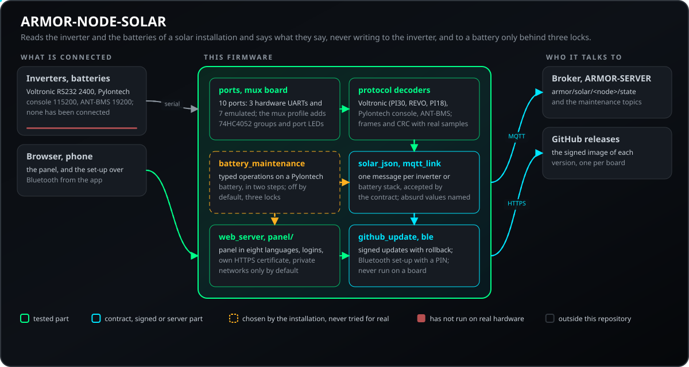
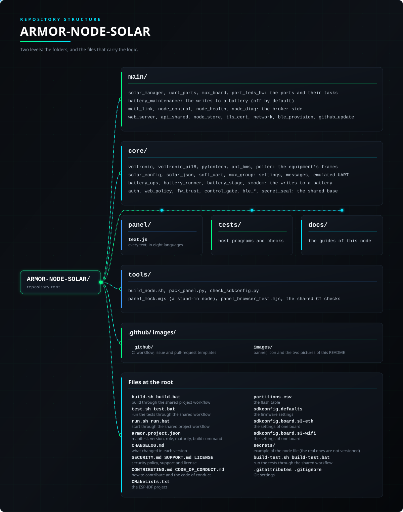

<p align="center">
  
</p>

# ☀️ ARMOR-NODE-SOLAR

<p align="center">
  <a href="README.md">🇺🇸 English</a> |
  <a href="README_spa.md">🇪🇸 Español</a> |
  <a href="README_fra.md">🇫🇷 Français</a> |
  <a href="README_ita.md">🇮🇹 Italiano</a> |
  <a href="README_deu.md">🇩🇪 Deutsch</a> |
  🇨🇳 <b>简体中文</b> |
  <a href="README_jpn.md">🇯🇵 日本語</a> |
  <a href="README_por.md">🇵🇹 Português</a>
</p>

### 太阳能网关节点：通过最多十个串口读取逆变器和电池（ESP32-S3 固件、其网页面板和协议库）

<p align="center">
  
  
  
  
  
  
</p>

---

**诚实性检查 - 今天真正能运行的部分：** 固件可在 ESP-IDF 5.5.5 容器中构建，其核心（设置、与每种设备的交互、模拟 UART 的运算、蓝牙通道、版本和签名检查：18 个测试程序中的 11,824 项检查）在计算机上用替身设备测试，它生成的消息被 ARMOR-COMMON 接受，面板已在浏览器中对照替身节点验证。**它从未在板上运行，也没有连接过任何逆变器或电池**：Wi-Fi、TLS 上的面板、更新、硬件和模拟 UART 以及协议格式（根据公开文档和记忆编写）都未经尝试。其测试中的 ANT-BMS 帧由其他人在自己的设备上捕获：本项目自己还没有读取过任何一帧。

---

## 📋 速览

| | |
|---|---|
| 版本 | `0.6.0` |
| 成熟度 | 可用 |
| 角色 | ESP32-S3 太阳能现场节点：逆变器和电池（家族：Field Nodes，上级：ARMOR-COMMON） |
| 技术栈 | C++17, ESP-IDF 5.5.5, ESP32-S3 |
| 测试 | 11824 项检查（18 个主机程序和 6 项 Python 检查，`ctest`） |
| 设备 | Voltronic / MPP Solar 逆变器、Pylontech 电池、ANT-BMS；10 个串口 |
| 运行位置 | ESP32-S3-WROOM-1 N16R8 或 Waveshare ESP32-S3-ETH；主机测试可在任何计算机上运行 |
| 真实硬件 | 暂无：没有制作板子，也没有连接逆变器或电池（仅有计算机测试、构建和浏览器中的面板） |
| 许可证 | GPL-3.0-or-later |

**跳转到：** [概述](#-概述) · [架构](#-架构) · [安全](#-安全与防护) · [接口](#-接口) · [配置](#-配置) · [快速开始](#-快速开始) · [测试](#-测试) · [故障排除](#-故障排除) · [结构](#-仓库结构) · [相关项目](#-相关项目)

## 🚦 项目状态

每一行是本仓库的一个部分，灯号表示它今天做到了哪一步。内容依据仓库能够展示的证据（测试、构建、运行），而不是计划。

🟢 已完成并验证 · 🟡 可用，有已知限制 · 🟠 部分完成或尚未验证 · 🔴 未完成或不可用

| 领域 | 状态 | 在这里的含义 |
|---|---|---|
| 软件 | 🟢 | 固件可在 ESP-IDF 5.5.5 容器中为两块板（Wi-Fi 和以太网）构建。 |
| 测试 | 🟢 | 18 个主机程序中的 11,824 项检查通过（`ctest`）：设置、与各类设备的交换、模拟 UART、蓝牙通道和版本检查。 |
| 协议与数据 | 🟡 | Voltronic、Pylontech 和 ANT-BMS 的帧、校验和与读数已对照文档中的帧和录制的样本检查；目前还没有与真实的逆变器或电池通信过。 |
| 界面 | 🟡 | 网页面板已在浏览器中对节点的模拟进行过测试，尚未在板子上测试。 |
| 硬件 | 🔴 | 尚未制作板子，也没有连接逆变器或电池：还没有在真实设备上运行过。 |
| 安全 | 🟡 | 设置码、限制错误密码次数的登录、蓝牙 PIN 和签名更新已在主机上测试；没有经过独立审查。 |
| 更新 | 🟠 | 哈希和 Ed25519 签名检查以及回滚逻辑在主机上通过；空中更新从未在板子上运行过。 |
| 写入设备 | 🟠 | 对 Pylontech 电池的写入默认关闭，只对照模拟器测试过。 |
| 集成 | 🟠 | 节点的消息已对照 ARMOR-COMMON 的共享模式和一致性向量验证。其 MQTT 客户端在测试中与真实的 Mosquitto 对接；还没有任何板子把这些消息发到服务器。 |
| 文档 | 🟢 | 八种语言、固件指南、接线说明和更新日志均为最新。 |

## 🎯 概述

* **两种开发板，一套固件：** 走 Wi-Fi 的 ESP32-S3-WROOM-1 N16R8（默认）和走以太网线的 Waveshare ESP32-S3-ETH（DHCP 或固定地址；保留自己的 Wi-Fi 网络以便从手机访问）。镜像在构建时选择（`tools/build_node.sh generic s3-wifi` 或 `generic s3-eth`）；引脚表、端口的默认引脚和接入方式随开发板而定，镜像只适用于对应的开发板。两者都能构建并已在电脑上测试，但都没在开发板上运行过。
* **节点固件**（Wi-Fi 的 ESP32-S3-WROOM-1 N16R8，或有线的 Waveshare ESP32-S3-ETH）：十个串口，三个硬件 UART 和七个模拟 UART（最高 19200 波特），每个都独立，可读取逆变器、电池或原始监视，因此一个节点可以只读逆变器、只读电池或两者混合。
* **节点的网页面板，** 与雷达节点相同：用 USB 控制台显示的代码进行设置、登录和用户、Wi-Fi（站点和接入点）、代理、带回滚的空中更新、日志、HTTPS，以及串口页面（显示每个端口收到的内容，用于尚未解码的协议）和读数页面，支持八种语言。
* **Voltronic / MPP Solar 逆变器**（Axpert、PIP、InfiniSolar 及其克隆），RS232 2400 波特：帧及其 CRC，以及读数 `QPIGS`（电网、输出、电池、光伏、状态位）、`QMOD`（模式）、`QPIWS`（按名称列出的警告和故障）和 `QPIRI`（额定值）。只能构造读取命令：设置会改变房屋的供电方式。三种方言，可在端口上选择或由端口自动找到（*auto*）：PI30、REVO（另一种 `QPIGS`，以校验和结尾的应答）和 PI18（`^P005GS`：InfiniSolar V、LV5048、SunGoldPower），仅读取。
* **Pylontech 电池**（US2000、US3000、US5000）：控制台的 `pwr` 表（每个模块的电压、电流、温度和电量）、`bat <n>`（每个电芯的电压和温度）以及 `info <n>`（型号、剩余和满容量、循环次数），汇总为一个电池组及其总容量和能量，还有带两项校验的 RS485 帧。这些格式是凭对公开控制台的记忆写成的，不同固件可能不同。各列按表头名称查找（包括带 Id 列、MosTempr 和 SysAlarm.St 的 US5000 V2.3 格式），剩余电量和均衡来自 `bat`，型号、额定容量和循环次数来自 `info` 和 `stat`，只询问一次并保留半小时。
* **Pylontech 模块自述的信息：** 型号、电路板和软件版本、电芯数量和允许的电流、寿命计数器（`stat`）、每个电芯的健康状态（`soh`，标出异常的一个），以及其事件日志的最新条目，保护名称与控制台打印的完全一致。控制台只读，管理员可以把端口收到的内容下载为文本文件。
* **节点的消息**（`armor/solar/<节点>/<设备>/state`，每台逆变器或电池组一条），在 ARMOR-COMMON 中以模式和一致性向量定义；各端口生成的内容会对照它们检查。
* **ANT-BMS 电池**（自制电池组上的黑色板，7S 至 32S），3.3 V UART，19200 波特：支持其固件的两种协议（节点先用一种询问，无应答再用另一种，并保持在有应答的那种），读取电芯、温度、荷电状态、电流、容量以及 MOSFET 和均衡器状态，并用在四种真实型号上抓取的帧做了验证。只读：其写入命令可能在带载时断开电池。端口页面上的按钮还可读取 BMS 的型号、版本以及 56 项保护和均衡设置（新协议，只读）。
* **通过蓝牙用手机配置：** 与雷达节点相同的通道。ARMOR 应用会以 `ARMOR-XXXXXX` 找到节点，并使用面板的用户和设置码来设置其名称、Wi-Fi、地址、代理和蓝牙模式（[协议](docs/BLE_PROVISIONING.md)）。除非另行设置，它只在节点还没有用户时监听。无线部分从未在电路板上运行过。
* **带多路复用器的底板（*mux* 配置）：** 三个硬件 UART，每个前面有一个 74HC4052，为最多八个端口（分为 4、2、2 三组）轮流使用各自的线路；每个端口有自己的速度和极性，并通过 74HC595 为每个端口提供一个指示灯；较高的 Pylontech 电池堆的电芯可以轮流读取。对标准方言的逆变器，**第二路光伏输入**（`QPIGS2`）和**并联系统的单元**（`QPGS`）是可选的读数。以上均未在电路板上运行过。
* **签名的无线更新：**节点只会从 GitHub 安装 SHA-256 匹配且带有维护者有效 Ed25519 签名的镜像（公钥在固件中，私钥从不离开维护者）；管理员在面板中手动上传的文件仍然被接受。面板的页面和消息有八种语言。
* **带 PIN 的蓝牙配对：**六位 PIN 由设置码派生，打印在 USB 控制台上并向管理员显示在面板中；手机必须输入它才能写入节点的设置。
* **尚未完成：** ANT-BMS 的蓝牙连接（节点使用更稳定的线缆）、Android 标签页，以及在真实开发板上用真实设备的运行。
* **只有家中才能使用面板：**面板默认只响应私有网络（或所有者列出的网络，如 VPN），拒绝会把保存者自己挡在外面的列表，按人和按地址统计错误密码，并可在服务器代理之后工作，从而无需公开节点就能在家外访问。
* **未知不等于没有：** REVO 逆变器没有警告查询，因此其消息带有 `warnings_known: false`，Studio 会把警告显示为“未知”而不是“无”。
* **可选的与代理加密连接(TLS):** 默认关闭,因此节点仍像以前一样使用未加密的 MQTT。代理页面中的一个开关和一个用于填写本安装自有证书颁发机构证书(PEM,最大 2 KB)的框,会让节点用 `mqtts://` 连接、只信任该机构,并检查代理证书是否为其所到达的地址而签发;不是单个 PEM 证书的内容会被拒绝。已有主机测试覆盖;握手尚未在电路板上运行。
* **健康报告：** 节点大约每分钟发布一次：已运行多久、上次为何重启、可用内存、连接与 Wi-Fi 信号、连接代理的次数以及记录的最后一个错误（`armor/health/<节点>`，即 ARMOR-COMMON 的 `node_health` 契约）。生成它的代码由所有节点共享并在计算机上测试；尚未在开发板上运行。
* **写入 Pylontech 电池（默认关闭）：** 只有定型操作——时钟、计数器和日志、重启、容量、电量重置、限值与保护、输出、序列号、外部存储器、通过 XMODEM-1K 升级固件，以及带禁用清单的专家控制台——分两步进行（准备，再用一次性令牌执行），操作前后都读取电池，服务密码只保存在节点中，测试使用模拟控制台。尚未在真实电池上试过：见[台架测试计划](docs/BATTERY_BENCH_TEST_PLAN.md)。
* **由服务器控制：** Studio 可以干净地重启节点、将其暂停至多一小时（自动恢复）、让其工作进入待机（无期限，重启后仍保持，节点保持连接并继续应答）、让它显示自己、请求诊断快照，并把它标记为维护中（`armor/control/<节点>/...`，ARMOR-COMMON 的 `node_control` 契约）。每条命令分两步，使用只属于该操作的一次性令牌，只有服务器可以在代理上写入，并且没有恢复出厂设置、擦除或深度睡眠。节点处于暂停或待机时，不向任何电池写入（正在进行的操作仍可取消），并继续读取逆变器和电池。 该代码由所有节点共用，并已在计算机上测试；尚未在电路板上运行过。
* **荒谬的数值会被点名，而不是被隐藏：** 当逆变器发来不可能的数字时，节点会把它限制在合同的上限，并在 `clamped` 中点名，因此服务器会把它显示为不真实；端口的原始转储只在面板正在查看时才生成。
* **无需线缆的诊断：** 在一次不干净的启动之后（崩溃、看门狗、电源跌落、内存分配失败），健康报告会在十分钟内说明原因；崩溃会留下核心转储（core dump），可在面板中查看、下载或删除；已保存的设置会在每次固件安装前被复制，并在更新损坏它们时恢复；管理员还可以通过服务器，用一次性令牌向节点索取诊断包或其日志。
* **可选的已存储机密封存:** 默认关闭(`security.seal_secrets`,或服务器的 `nodes.nvs_encryption`)。开启后,节点保存的密码、令牌、密钥、PIN 和密码哈希会用 ChaCha20-Poly1305 封存,其余内容仍可读取;开启或关闭时会无损重写,即使节点中途停止也不会丢失。不会烧写 eFuse,闪存也不加密:密钥在同一芯片的一个分区中,因此**不能**防范持有电路板的人;在该分区出现之前安装的节点会保持原样,直到用新的分区表重新烧录。

## 🧩 在 A.R.M.O.R. 中的角色

ARMOR-NODE-SOLAR 是住宅太阳能设备与家族之间的网关。它通过最多十个串口读取逆变器和电池，并把读到的内容发布给 [ARMOR-SERVER](https://github.com/JuanenRac/ARMOR-SERVER)，由后者保存历史、合计和报警；[ARMOR-STUDIO](https://github.com/JuanenRac/ARMOR-STUDIO) 的*逆变器*和*电池*菜单以及 [ARMOR-ANDROID-CONTROL](https://github.com/JuanenRac/ARMOR-ANDROID-CONTROL) 的太阳能界面显示这些内容。它只读取：从不向任何设备写入设置。

| 名称 | 方式 | 用途 |
|---|---|---|
| ARMOR-SERVER | MQTT `armor/solar/<node>/<device>/state` | 每个逆变器或电池组接收一条消息；下达电池维护命令 |
| ARMOR-STUDIO | 菜单、面板链接 | 显示逆变器和电池并打开节点面板 |
| ARMOR-ANDROID-CONTROL | Bluetooth | 在现场设置节点并显示能源界面 |
| ARMOR-COMMON | 太阳能合约 | 消息按其模式校验；公共固件由此复制 |

## 🏛️ 架构

<p align="center">
  
</p>

## 🖼️ 屏幕截图

在测试台上以 1920×1080 截取，使用示例数据，背后没有真实的安装。

<table>
<tr><td width="50%" valign="top"><br><sub>概览：节点状态一目了然——网络、代理、固件及其上报内容。</sub></td><td width="50%" valign="top"><br><sub>端口：节点的串行端口以及每个端口上的设备。</sub></td></tr>
<tr><td width="50%" valign="top"><br><sub>读数：节点此刻读取到的内容，以及每个数值的时效。</sub></td><td width="50%" valign="top"><br><sub>网络：节点的以太网或 Wi-Fi 地址设置，在其自带的网页面板中配置。</sub></td></tr>
</table>

## 🔒 安全与防护

| 威胁 | 防御 |
|---|---|
| 明文或编译进固件的密码 | PBKDF2-HMAC-SHA256，10 000 轮；固件中没有密码（没有用户的节点会进入设置）；最多 4 个用户（管理员或查看者），8 到 64 个字符；最多 6 个会话，空闲 30 分钟 |
| 接管刚刷写的节点 | 设置需要启动码：构建时的码（`CONFIG_ARMOR_SETUP_CODE`），或保存在闪存中并显示在 USB 控制台上的随机码；有机群密钥时为 `HMAC-SHA256(密钥, MAC)`；它也是设置用 Wi-Fi 的密钥（WPA2，绝不桥接） |
| 从互联网访问面板 | 默认只响应家庭的私有网络（10/8、172.16/12、192.168/16、169.254/16、127/8，以及某些 VPN 使用的 100.64/10）；设置 `web.admin_sources` 可列出其他 IPv4 地址和网络（8 项，120 个字符）；除公开身份 `GET /api/v1/session` 外，其余一律拒绝；会把保存者自己锁在外面的列表会被拒绝 |
| 通过 HTTP 明文访问面板 | 在 443 端口提供 HTTPS，证书由节点自己生成（自签名、存于闪存，显示 SHA-256 指纹以便比对）；面板可设为 http、https 或两者；会话 Cookie 始终为 HttpOnly 和 SameSite=Strict（TLS 下还有 Secure） |
| 来自 GitHub 的伪造固件 | 只有 SHA-256 匹配且带有维护者密钥有效 Ed25519 签名的镜像才会被安装（`no_checksum`、`no_signature`、`bad_signature`、`checksum_mismatch`、`wrong_firmware`、`not_newer`、`version_mismatch` 会拒绝）；管理员手动上传不做校验：这是明确的限制 |
| 劫持蓝牙设置 | 由设置码派生的 6 位 PIN，显示在 USB 控制台并对管理员可见；手机必须先输入才能写入设置；设置窗口时长为 `CONFIG_ARMOR_BLE_SETUP_MINUTES`（默认 10，范围 1 到 120） |
| 造成危害的远程命令 | 两步操作，使用与该操作绑定的一次性令牌；只有服务器能向代理写入这些主题；暂停最长一小时；远程命令没有恢复出厂、擦除和深度睡眠 |
| 拿到电路板的人读取存储的机密 | 可选（默认关闭，开关为 `security.seal_secrets` 或服务器的 `nodes.nvs_encryption`）：用 ChaCha20-Poly1305 保护密码、令牌、密钥、PIN 和哈希。它不加密闪存也不烧写 eFuse：密钥位于同一芯片的分区中，因此无法防御拿到电路板的人 |
| 与代理的明文连接 | 可选 TLS（`mqtts://`），使用所有者自己的证书颁发机构（PEM 最大 2 KB）并检查名称；默认关闭。握手只在主机测试中运行过，没有在电路板上运行 |
| 因错误或攻击者而写入电池 | 三道锁：节点设置 `battery.write_enabled`（管理员）加电池的服务密码，服务器的 `ARMOR_BATTERY_WRITE=1`，以及代理对 `armor/solar/<节点>/maintenance/command` 和 `.../result` 的访问列表 |
| 被重放或窃取的写入命令 | 两步（先布防，再用一次性令牌执行），布防窗口 120 秒，对同一端口的两次写入间隔 30 秒，10 分钟内失败 3 次则锁定 5 分钟；需要再次输入电池序列号，电池必须空闲且无严重报警，固件镜像保留 30 分钟并经过校验 |
| 向逆变器或 ANT-BMS 写入 | 逆变器（设置会改变住宅的供电方式）和 ANT-BMS（可能在负载下断开电池）的写入命令甚至无法构造 |
| 荒谬的数值被当作真实值显示 | 不可能的数值会被限制在合约上限并在 `clamped` 中列出，服务器据此将其显示为非真实值；REVO 逆变器没有告警查询，所以其消息写 `warnings_known: false`，而不是声称没有告警 |

从未从真实逆变器或电池读取过任何帧；格式依据公开文档和记忆编写，测试中的 ANT-BMS 帧由他人捕获。请阅读 [docs/BATTERY_MAINTENANCE.md](docs/BATTERY_MAINTENANCE.md) 和 [SECURITY.md](SECURITY.md)。

## 🔌 接口

| 部分 | 作用 |
|---|---|
| MQTT | `armor/solar/<节点>/<设备>/state`（每个逆变器或电池组一条消息，类型为 ARMOR-COMMON 合约中的 `inverter` 或 `battery`）、`armor/solar/<节点>/maintenance/{command,result}`、`armor/health/<节点>`（遗嘱）、`armor/control/<id>/{command,result,maintenance}` 和 `armor/control/all/command` |
| 端口 | 10 个串口（3 个硬件 UART 和 7 个模拟 UART，模拟时最高 19200 波特）；每个端口有一个类型：`voltronic`（2400 波特，每 5 秒）、`pylontech`（115200，每 10 秒）、`ant`（19200，每 5 秒）或 `raw`（9600，仅监听，不发布任何内容）；逆变器方言有 `auto`、`pi30`、`revo`、`pi18`；mux 方案有 3 组端口 |
| 查询 | Voltronic：`QPIGS`、`QMOD`、`QPIWS`、`QPIRI`（带 mux 的标准逆变器还有 `QPIGS2`、`QPGS`）；Pylontech 控制台：`pwr`、`bat <n>`、`info <n>`、`stat`、`soh`、事件日志，最多 8 个模块逐个电芯查询 |
| 面板 | 系列共有的路由（`tests/check_routes.py` 检查面板调用的每条路由都存在）加上端口和读数页面；51 个带八种语言文字的错误码（`panel/text.js` 中 772 行）；Studio 的菜单见 [docs/STUDIO_MENUS.md](docs/STUDIO_MENUS.md) |

## ⚙️ 配置

| 变量 | 默认值 | 作用 |
|---|---|---|
| `enabled`, `kind`, `name`, `baud`, `rx`, `tx`, `de`, `poll_s`, `modules`, `dialect` | - | 每个端口的设置：是否启用、类型、主题中的设备名、速度（0 = 该类型的默认值）、引脚（以及 RS485 的 DE/RE 引脚）、轮询周期（0 = 该类型的默认值）、模块数和逆变器方言；备用网络最多 3 个，备用代理最多 2 个 |
| `battery.write_enabled` | off | 节点对 Pylontech 电池写入的锁（管理员，使用电池的服务密码，该密码从不离开节点） |
| `CONFIG_ARMOR_BOARD_S3_WIFI` / `_S3_ETH` | wifi | 电路板：ESP32-S3-WROOM-1 N16R8（Wi-Fi，默认）或 Waveshare ESP32-S3-ETH |
| `CONFIG_ARMOR_NODE_ID`, `_SETUP_CODE`, `_FLEET_SECRET`, `_MQTT_*`, `_HEARTBEAT_S`, `_BLE_SETUP_MINUTES`, `_BOOT_FACTORY_RESET` | - | 所有节点共有的设置：名称（为空则为 `armor-` 加 MAC 的最后字节）、设置码（为空则随机）、机群密钥（16 个字符以上，绝不放入仓库）、最初的代理设置、心跳（2 到 300 秒）、蓝牙设置的分钟数（1 到 120）以及用 BOOT 重置（前 30 秒内按 8 秒） |

## 🚀 快速开始

**要求:** 用于主机测试的 C++17 编译器；用于构建镜像的 ESP-IDF 5.5.5 容器；ESP32-S3-WROOM-1 N16R8 或 Waveshare ESP32-S3-ETH。

```bash
cmake -S tests -B build/host && cmake --build build/host && ctest --test-dir build/host   # host tests, -Werror
build/host/emit_poller_samples | python tests/check_samples.py   # what the ports make is accepted by ARMOR-COMMON
tools/build_node.sh generic                       # the image for the N16R8 board in the ESP-IDF container: dist/generic-s3-wifi.bin
tools/build_node.sh generic s3-eth               # the same firmware for the Waveshare ESP32-S3-ETH (Ethernet): dist/generic-s3-eth.bin
node tools/panel_mock.mjs --user admin:adminpass123   # the panel without a board
```

参见[固件指南](docs/NODE_FIRMWARE.md)（开发板、端口、首次启动和台架检查清单）以及[接线说明](docs/NODE_HARDWARE.md)。

## 🧪 测试

```bash
cmake -S tests -B build/host && cmake --build build/host && ctest --test-dir build/host
python -I tools/armor_ci_validate.py
```

`ctest` 运行 18 个主机测试程序和 6 个 Python 检查；主机程序统计的检查共 11824 项，使用 `-Werror` 构建。

Python 检查：八种语言的面板文字、任务、保存路径、受锁保护的蓝牙会话以及面板调用的路由（部分节点还包括 HTTP 状态码或字体字形）

主机测试需要任意 C++17 编译器（Linux、WSL、MSYS2）；网页面板还会在真实浏览器中对着模拟节点（`tools/panel_mock.mjs`、`tools/panel_browser_test.mjs`）进行验证。

`test_clock` 只输出 `ok`，没有计数器；其余每个程序都会报告其检查数。测试用的真实帧在 `tests/pylontech_real.hpp`、`pylontech_us2000_real.hpp`、`pylontech_logs_real.hpp`、`ant_frames.hpp` 和 `battery_bench.hpp` 中。

## 🏗️ 构建与发布

`tools/build_node.sh` 在 ESP-IDF 5.5.5 容器中构建镜像，发布版带有镜像、其 SHA-256 和 Ed25519 签名，每块电路板一份；镜像第一次通过 USB-C 写入，之后从面板更新。

## 🩺 故障排除

| 现象 | 原因 | 处理 |
|---|---|---|
| 忘记了密码，或节点不再加入网络 | 处于设置状态且 90 秒后仍无地址的节点会开启自己的 Wi-Fi `ARMOR-SETUP-xxxxxx`（打开 `http://192.168.4.1/`） | 要重新开始，请在上电后 30 秒内按住 BOOT 8 秒（会清除设置和用户），或使用面板中的*恢复出厂设置* |
| 来自 GitHub 的更新被拒绝 | 发布版缺少校验和或签名，或二者不匹配（`e_no_checksum`、`e_no_signature`、`e_checksum_mismatch`、`e_bad_signature`），没有适用于此电路板的镜像（`e_no_asset_for_board`），或属于另一个项目（`e_wrong_firmware`） | 节点未发生任何变化；请重试，或由管理员手动上传文件 |
| 对电池的写入被拒绝并带有代码 | `serial_mismatch`、`not_pylontech`、`no_battery`、`unknown_model`、`not_idle`、`critical_alarm`、`busy`、`cooldown`、`locked`、`not_armed`、`bad_token`、`expired`、`disabled`、`image_missing`、`image_mismatch` 等：节点拒绝任何与已布防操作不完全一致的内容 | 查看结果中的代码，修复原因后重新布防该操作（见 [docs/BATTERY_MAINTENANCE.md](docs/BATTERY_MAINTENANCE.md)） |
| 端口没有发布任何内容 | 端口已关闭，类型为 `raw`（仅监听），速度或引脚与设备不符，或设备没有响应 | 检查端口设置和接线（见 [docs/NODE_HARDWARE.md](docs/NODE_HARDWARE.md)）；面板在查看某个端口时会显示其原始转储 |

## 📂 仓库结构

<p align="center">
  
</p>

<details>
<summary>目录树的文本版</summary>

```text
ARMOR-NODE-SOLAR/
├── main/                                固件：一个 ESP-IDF 组件
├── core/                                不依赖 ESP-IDF 的逻辑，在计算机上测试
├── panel/                               嵌入固件的网页面板
├── tests/                               主机测试和 Python 检查
├── docs/                                10 份指南：协议、消息、维护、硬件
├── tools/                               构建、打包和检查工具
├── .github/                             CI 工作流以及 Issue 和 Pull Request 模板
├── images/                              横幅、图标和本 README 的两幅图
├── build.sh build.bat                   通过共享的项目工作流构建
├── test.sh test.bat                     通过共享工作流运行测试
├── run.sh run.bat                       通过共享的项目工作流启动
├── armor.project.json                   清单：版本、角色、成熟度、构建命令
├── CHANGELOG.md                         每个版本的变化
├── SECURITY.md SUPPORT.md LICENSE       安全策略、支持和许可证
├── CONTRIBUTING.md CODE_OF_CONDUCT.md   如何贡献与行为准则
├── CMakeLists.txt                       ESP-IDF 项目
├── partitions.csv                       闪存分区表
├── sdkconfig.defaults                   固件设置
├── sdkconfig.board.s3-eth               某块电路板的设置
├── sdkconfig.board.s3-wifi              某块电路板的设置
├── secrets/                             节点文件示例（真实文件不纳入版本管理）
├── build-test.sh build-test.bat         通过共享工作流运行测试
└── .gitattributes .gitignore            Git 设置
```

</details>

## 🗺️ 路线图与已知限制

**目前已知的限制**

* Voltronic、Pylontech 和 ANT-BMS 的帧、校验和与读数已对照文档中的帧和录制的样本检查；目前还没有与真实的逆变器或电池通信过。
* 网页面板已在浏览器中对节点的模拟进行过测试，尚未在板子上测试。
* 尚未制作板子，也没有连接逆变器或电池：还没有在真实设备上运行过。
* 设置码、限制错误密码次数的登录、蓝牙 PIN 和签名更新已在主机上测试；没有经过独立审查。
* 哈希和 Ed25519 签名检查以及回滚逻辑在主机上通过；空中更新从未在板子上运行过。
* 对 Pylontech 电池的写入默认关闭，只对照模拟器测试过。

**下一步**

* 在真实电路板上连接真实逆变器和电池运行节点，然后试验 ANT-BMS 的蓝牙连接（目前使用线缆）、空中更新以及对电池的写入。

## 🌍 语言

README 和文本提供英语、西班牙语、法语、意大利语、德语、汉语、日语和欧洲葡萄牙语版本。

## 🔗 相关项目

**A.R.M.O.R.**（Autonomous Radar & Multimodal Observation Range）是一个由相互独立的仓库组成的周界安全系统。每个仓库都有自己的版本、自己的测试和自己的 README；这是整个系列：

* **[ARMOR-COMMON](https://github.com/JuanenRac/ARMOR-COMMON)** - 消息契约、验证器、一致性向量和生成的类型
* **[ARMOR-NODE-RADAR](https://github.com/JuanenRac/ARMOR-NODE-RADAR)** - 面向 ESP32-S3 的现场节点固件，配三个雷达和自带的网页面板
* **ARMOR-NODE-SOLAR**（本仓库） - 太阳能逆变器和电池的协议，以及网关节点的消息
* **[ARMOR-NODE-ELECTRICAL](https://github.com/JuanenRac/ARMOR-NODE-ELECTRICAL)** - 电气节点：电表、电网读数的消息和切换规则
* **[ARMOR-NODE-ALARM](https://github.com/JuanenRac/ARMOR-NODE-ALARM)** - 报警节点与面板：防区、布防、延时、警笛和 PIN，可配合服务器也可独立使用
* **[ARMOR-NODE-HMI](https://github.com/JuanenRac/ARMOR-NODE-HMI)** - 触摸面板：壁挂屏幕上的系统状态、布防与确认，以及语音助手的所在
* **[ARMOR-NETWORK](https://github.com/JuanenRac/ARMOR-NETWORK)** - 本地网络：其设备、互联网以及变化
* **[ARMOR-SERVER](https://github.com/JuanenRac/ARMOR-SERVER)** - 中央协调器：遥测、报警、设备、太阳能读数和摄像头
* **[ARMOR-STUDIO](https://github.com/JuanenRac/ARMOR-STUDIO)** - 网页控制台：摄像头、雷达、报警、太阳能以及 2D/3D 场地设计器
* **[ARMOR-ANDROID-CONTROL](https://github.com/JuanenRac/ARMOR-ANDROID-CONTROL)** - 带实时 2D/3D 雷达的 Android 操作员客户端
* **[ARMOR-IOS-CONTROL](https://github.com/JuanenRac/ARMOR-IOS-CONTROL)** - iPhone 操作员客户端
* **[ARMOR-SERVER-AI](https://github.com/JuanenRac/ARMOR-SERVER-AI)** - 视觉推理策略，会解释其决策且从不驱动设备
* **[ARMOR-VISION](https://github.com/JuanenRac/ARMOR-VISION)** - 面向 Jetson Orin NX 的摄像头区域、遮罩和检测规则
* **[ARMOR-VOICE-AI](https://github.com/JuanenRac/ARMOR-VOICE-AI)** - 离线语音意图，附带无法伪造的确认
* **[ARMOR-HARDWARE](https://github.com/JuanenRac/ARMOR-HARDWARE)** - 外壳、电子器件和台架验收矩阵
* **[ARMOR-DEVOPS](https://github.com/JuanenRac/ARMOR-DEVOPS)** - 部署、CM5 测试台、备份和 TLS
* **[ARMOR-SIMULATOR](https://github.com/JuanenRac/ARMOR-SIMULATOR)** - 带可重复故障的离线遥测模拟器
* **[ARMOR-UPDATER](https://github.com/JuanenRac/ARMOR-UPDATER)** - 检测、安装和更新生态系统自身的仓库
* **[ARMOR-DOCS](https://github.com/JuanenRac/ARMOR-DOCS)** - 架构、安全基线和能力矩阵

## 📚 文档

* [节点固件](docs/NODE_FIRMWARE.md)：电路板、端口、首次启动和台架检查清单
* [接线](docs/NODE_HARDWARE.md)、[协议](docs/PROTOCOLS.md)和[消息](docs/SOLAR_MESSAGES.md)
* [电池维护](docs/BATTERY_MAINTENANCE.md)及其[台架测试计划](docs/BATTERY_BENCH_TEST_PLAN.md)
* [Studio 菜单](docs/STUDIO_MENUS.md)、[台架测试](docs/BENCH_TESTS.md)、[设置码](docs/SETUP_CODE.md)和[蓝牙配置](docs/BLE_PROVISIONING.md)
* [能力矩阵：哪些已被证明，哪些没有](https://github.com/JuanenRac/ARMOR-DOCS/blob/main/docs/CAPABILITY_MATRIX.md)
* [项目目录：版本以及各仓库之间如何相互依赖](https://github.com/JuanenRac/ARMOR-DOCS/blob/main/docs/PROJECT_CATALOG.md)
* [本仓库的更新日志](CHANGELOG.md)

## 🤝 参与贡献与社区

* 提交 Pull Request 之前请运行 `ctest --test-dir build/host` and `python -I tools/armor_ci_validate.py`：必须通过。参见 [CONTRIBUTING.md](CONTRIBUTING.md) 和[行为准则](CODE_OF_CONDUCT.md)。
* README 提供八种语言，由 ARMOR-DOCS 中的源文件生成：文本的修改在那里进行。
* 组件之间消息的变更从 ARMOR-COMMON 开始。
* 不要把仅仅构建过的东西描述为已在板子上运行。
* 请私下报告漏洞：[SECURITY.md](SECURITY.md)。问题、想法和报告：electrohobby3d@gmail.com（[SUPPORT.md](SUPPORT.md)）。

## 👤 作者

**JuanenRac (Electro Hobby 3D)** · electrohobby3d@gmail.com

## 📜 许可证

GPL-3.0-or-later - 见 [LICENSE](LICENSE)。
